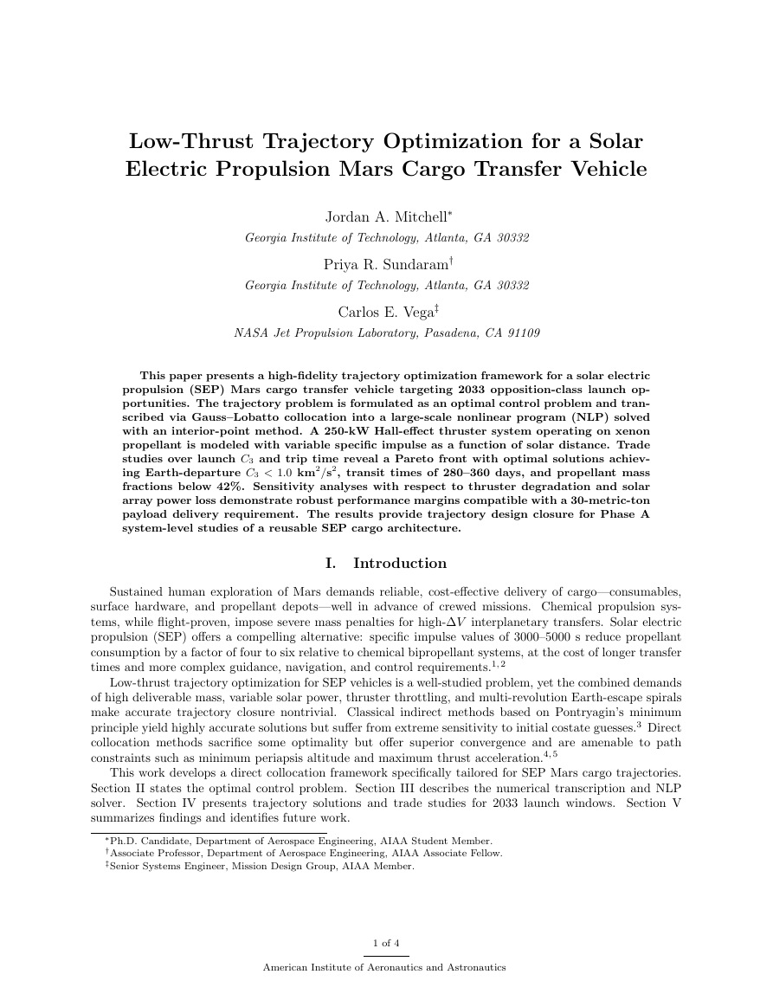

# AIAA LaTeX Template — Aerospace Conference Paper

[](https://letx.app/templates/conferences/aiaa-conference-paper/)
[](LICENSE)
[](#compile-locally)

**A compile-tested AIAA technical conference paper template for aerospace and space engineering submissions.**

Edit and compile this template instantly in your browser — no LaTeX install — at **[letx.app](https://letx.app/templates/conferences/aiaa-conference-paper/)**, with real-time collaboration and one-second compiles.



## Use it online (recommended)
Open **[this template on LetX »](https://letx.app/templates/conferences/aiaa-conference-paper/)** and click *Open as Template* — it compiles in ~1 second, free, in your browser.

## <a name="compile-locally"></a>Compile locally
```bash
git clone https://github.com/Shahriar-Labs/aiaa-latex-template.git
cd aiaa-latex-template
latexmk -pdf main.tex
```

## More free LaTeX templates
This is one of **80+ free, open-source templates** in the [LetX LaTeX Template Library](https://github.com/Shahriar-Labs/latex-templates) — research papers, CVs, grants, lab reports, posters and more. Browse them all at **[letx.app/templates](https://letx.app/templates)**.

Built by [Shahriar Labs](https://shahriarlabs.com), makers of **[LetX](https://letx.app)** — the fast, private, real-time collaborative LaTeX editor (an Overleaf alternative).

## License
MIT — free for personal and commercial use. See [LICENSE](LICENSE).
